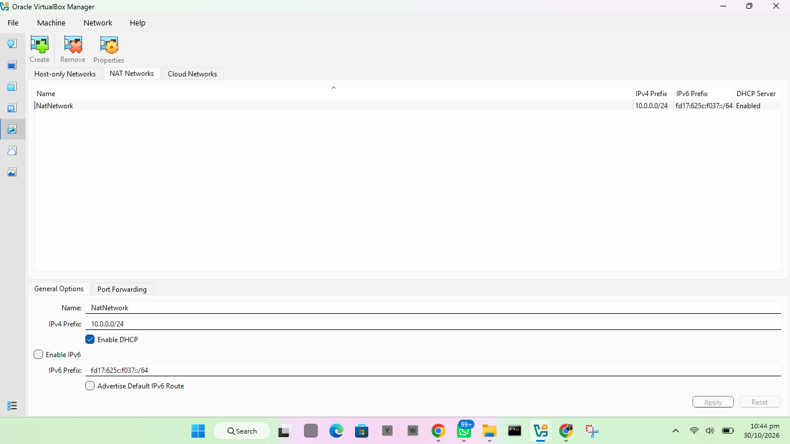
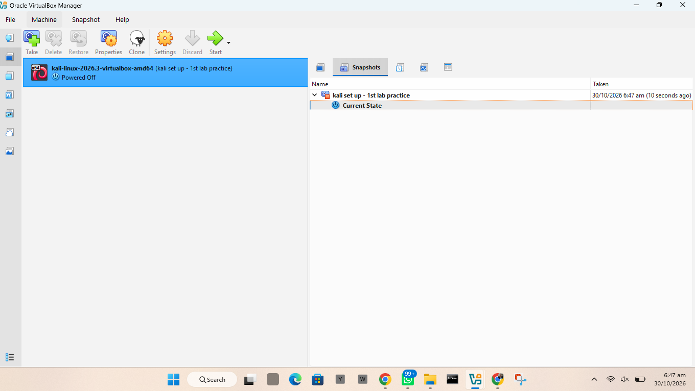

# MY-FIRST-CYBERSECURITY-HOME-LAB-SETUP-KALI-LINUX-AND-VIRTUAL-BOX
Documenting my first cybersecurity home lab: setting up VirtualBox and Kali Linux, step by step, with notes on what I learned along the way.

My first cybersecurity home lab, built with VirtualBox and Kali Linux. I wrote down every step, including the mistakes, so other beginners can follow along.

About This Project

I am new to cybersecurity, and this is my first hands-on project. The goal was to set up a safe place on my own computer where I can practice cybersecurity skills without touching anything real.

The lab runs on a private virtual network. Later, I plan to add more virtual machines to the same network to use as practice targets.

What I Wanted to Do

- Install VirtualBox
- Set up Kali Linux as a virtual machine
- Create a private network for the lab
- Get Kali connected to the network and the internet
- Check that everything works
- Take a snapshot so I can go back to a clean setup if I break something
- Document the whole process

What I Will Use the Lab For

As I keep learning, I plan to use it to practice things like:

- Network scanning
- Finding open ports
- Basic vulnerability checks
- Looking at network traffic
- Trying out security tools

How I Set It Up

Step 1: Install VirtualBox and 7zip

VirtualBox: https://virtualbox.org/wiki/Downloads

7-zip: https://7-zip.org/download.html

Step 2: Download Kali Linux https://kali.org/get-kali


Step 3: Create the Network
Go to files
Click on tools 
Select network 
See problem 1 at the end of this read me if you can’t find network icon.
Click on NAT Network 
Click on the create icon and edit the settings 
Click ok

	NAT Network Settings:
Network Address	10.0.0.0/24
Kali IP Address	10.0.0.2/24
Default Gateway	10.0.0.1
DNS Server	8.8.8.8



Step 4: Import Kali Linux
Extract the kali zip file downloaded using 7Zip 
Click on machine in the virtual box
Select open 
Navigate to locate the extracted kali file and select 
After it loads, click on start


Step 5: Check the Network on Kali

I checked that Kali had the right IP address and could reach the internet. At first the internet did not work, so I had to fix it with a few commands.

![alt text](

Step 6: Take a Snapshot

Once everything worked, I took a snapshot and named it something like "Clean Kali - Network Setup". If I mess up later, I can go back to this point.

How I Checked That It Works

Problems I Ran Into

I hit some problems along the way. I am keeping them here because I learned the most from them.

Problem 1: I could not find the Network button in VirtualBox

What happened: I wanted to create my lab network, but the Network button was not showing in the Tools menu. 

How I fixed it:

1. Click File, then select Preferences.
2. Click Expert.
3. Close the dialog box.
4. Click Tools. The Network button now shows.

Problem 2: Not enough space to extract Kali

What happened: The Kali file would not extract because my computer did not have enough free space.

**How I fixed it:** I used the Control Panel to free up space. I removed programs I no longer use and cleared some files from my Downloads folder. After that, the extraction worked.

Problem 3: No internet connection in Kali

What happened: After setting up Kali, I had no internet connection.

How I fixed it: I ran these three commands in the Kali terminal:

```
sudo nmcli connection modify "Wired connection 1" ipv4.dad-timeout 0
sudo nmcli connection down "Wired connection 1"
sudo nmcli connection up "Wired connection 1"
```

The first command changes a network setting. The next two turn the connection off and back on so the change takes effect. After this, my connection came back.

Note: "Wired connection 1" is the name of my connection. Yours may be different. You can check the name with `nmcli connection show` before running the commands.

What I Learned

1. It is never too late to ask for help.

When I got stuck, I reached out to other people in cybersecurity. I learned that having a network of other professionals and learners is a real advantage. Someone has probably faced the same problem before, and asking is faster than struggling alone.

2. Finding solutions is part of the work.

A lot of this project was searching, trying things, and finding out what works. I discovered new things I did not plan to learn. I am getting more comfortable figuring things out step by step.

3. Challenges are for learning, not for giving up.

Some things did not work the first time. At first that felt discouraging, but every error taught me something. I now see problems as part of the process.

4. Snapshots are very helpful.

Taking a snapshot of a clean setup means I can experiment without fear of breaking everything.

5. Writing things down helps.

Documenting my steps helped me understand them better, and it will help me if I need to rebuild the lab.

What Is Next

- Add a target machine to the network for practice
- Try basic scans with Nmap
- Keep updating this repo as I learn


Author
Prudence Selasi Dela-Boso

https://www.linkedin.com/in/prudence-selasi-dela-boso-1a91472b9?utm_source=share_via&utm_content=profile&utm_medium=member_ios

